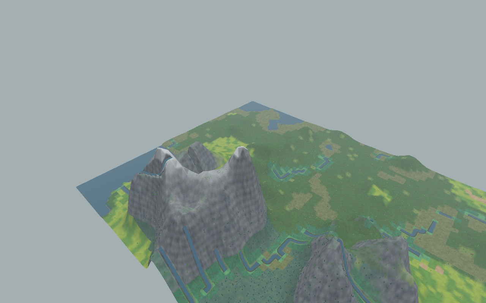
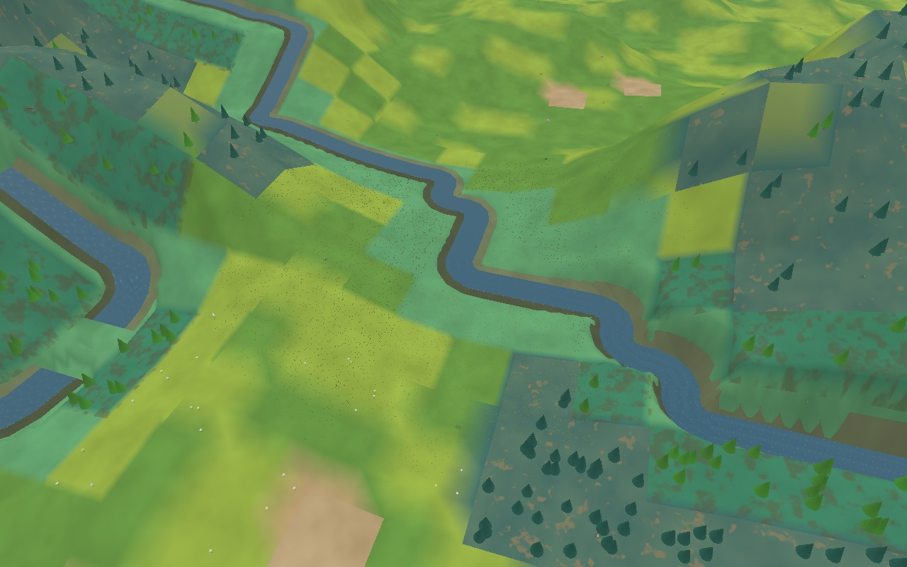
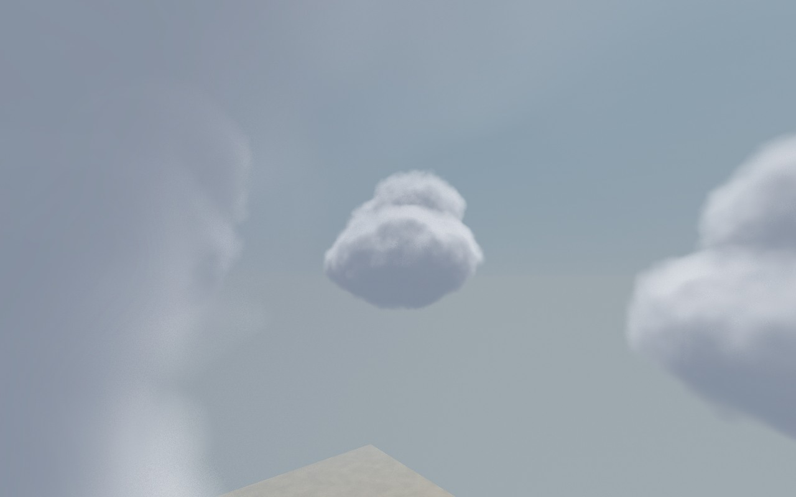
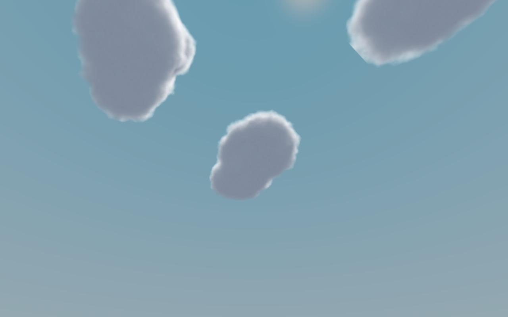
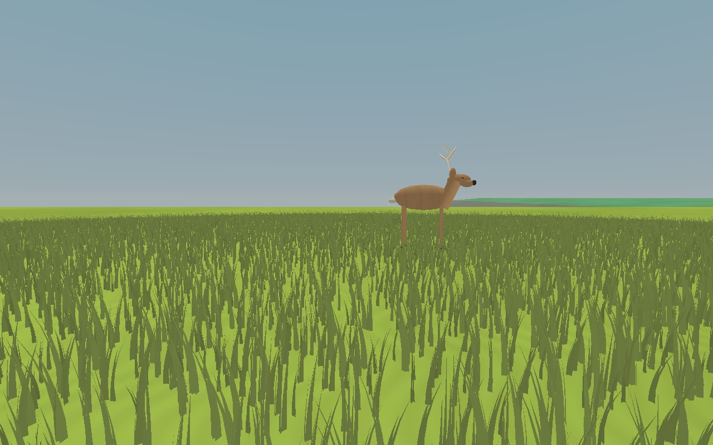
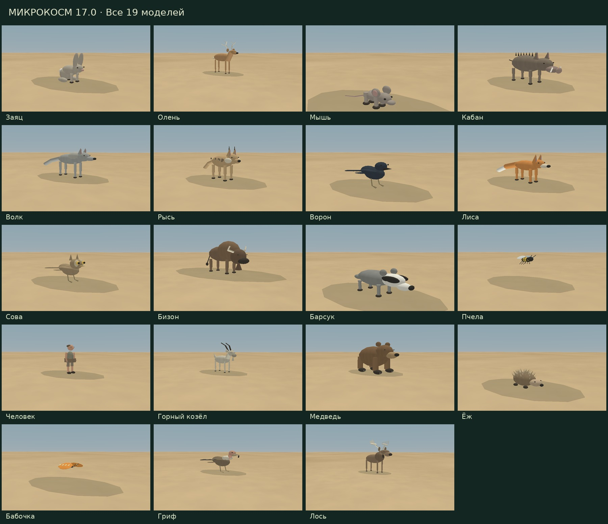

# Микрокосм 17.0

Автономная симуляция экосистемы с 3D-картой и прогулкой от первого лица.

**[Скачать версию 17.0 — ZIP](https://github.com/yaryomin-sketch/GPT/raw/refs/heads/main/releases/microcosm_17_0_package.zip)**

Распакуйте архив и откройте **microcosm_17_0_pc.html**. Интернет для игры не нужен. Для загрузки всего репозитория: **Code → Download ZIP**.

## Что изменилось

Переработаны горы, материалы биомов, русла, берега и масштаб объектов. Вместо плоских облачных фигур используется объёмная плотность со светотенью и отсечением по глубине сцены. Исправлены все шесть пропущенных видов: теперь у всех 19 видов есть собственная модель, включая грифа и его полёт.

[Изменения 17.0](microcosm_17_0_RELEASE_NOTES.md) · [Инструкция](README_17_0_RU.md)

## Изображения из проверки

Горы исходного мира:

Река исходного мира:

Облако сбоку и снизу — два ракурса одного объёма в тестовой облачной погоде:

Масштаб травы рядом с оленем:

Все модели:

[Тест 19 материалов](previews/biomes.jpg) · [Гриф в полёте](previews/vulture-flight.jpg)

## Управление

«Гулять по миру» — разворот карты и вид от первого лица. WASD / стрелки — ходьба; Shift — быстрее; пробел — прыжок; мышь — обзор; Esc — возврат. При недоступности захвата мыши используйте перетаскивание. На карте колесо меняет масштаб, правая кнопка — поворот и наклон.

## Исходники и проверки

`index.html` — готовая игра для статического хостинга. `microcosm_17_0_pc.html` — тот же файл с номером версии. В `src` находятся рендерер, стили и сборщик, в `tests` — проверки и результаты. Исходная версия 15.0 нужна сборщику: `python src/build.py`.

Проверки: `node tests/scene.cjs`, `node tests/water-edges.cjs`, `python tests/render_egl.py`, `node tests/simulation.cjs`. Для EGL нужны OpenGL ES и Pillow.

Графика стилизованная. Проверки отрисовки выполнены в ES3-контексте; полный прогон браузерного интерфейса, системные разрешения и FPS на устройстве пользователя ещё требуют проверки. Каждый посетитель получает отдельную локальную симуляцию.

Предыдущая версия: [16.1](releases/microcosm_16_1_package.zip).
